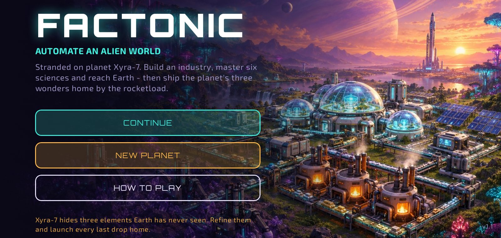
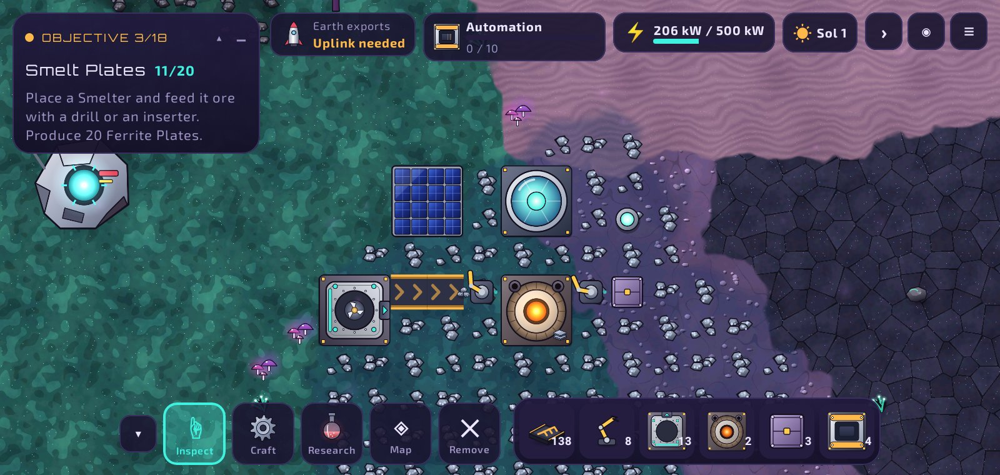
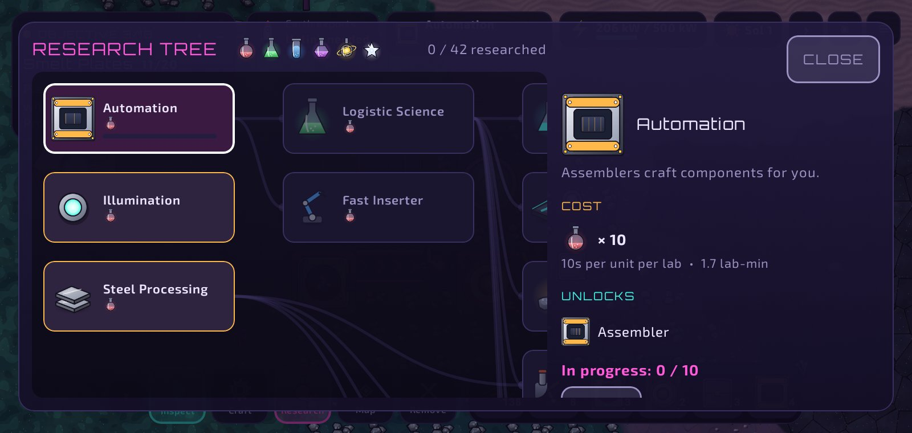
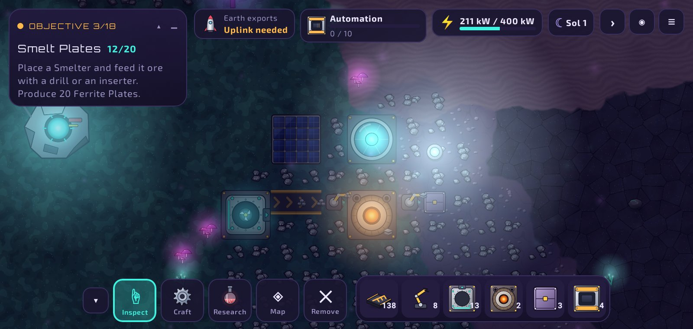
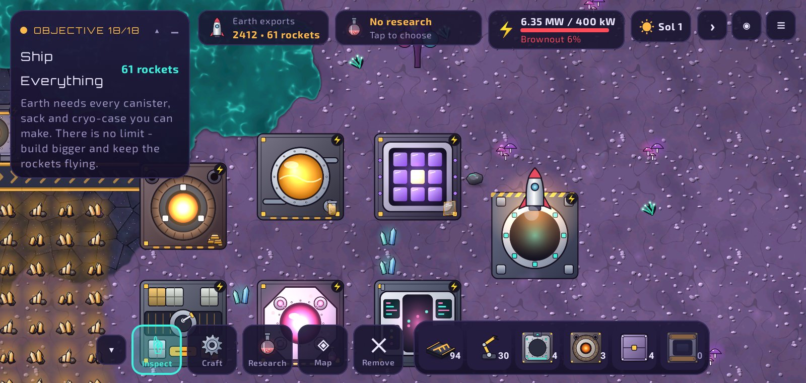
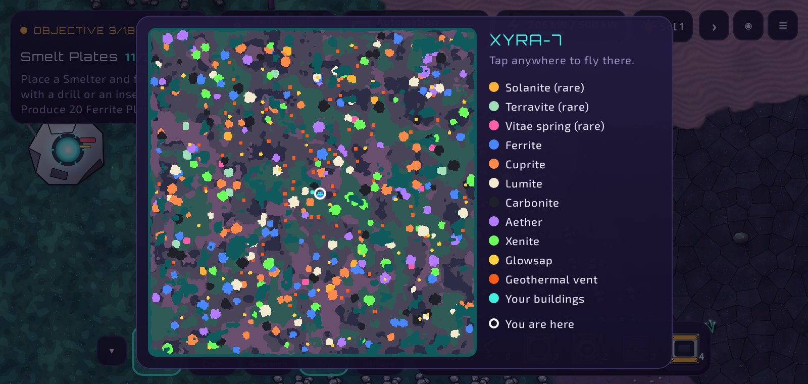

# Factonic 1.0

A factory-automation game for Android, set on the alien world **Xyra-7**. Your ship crash-landed. Mine strange ores, smelt them, automate production with belts and inserters, research six tiers of science, and establish the **Earth Uplink**. Then the real work starts: Xyra-7 hides three elements Earth has never seen, and Earth wants every last drop.

- **Solanite**: ore, then pure ingots, then liquid solanite, then **Xyra Epoxy** canisters. Cured epoxy also becomes film, bricks and glass.
- **Terravite**: ore, then ingots, then fine Terravite Cement, then **Xenocrete Sacks** (the bags are made from cured Solanite epoxy film).
- **Vitae**: a living protein ooze pumped from rare springs. It goes through plasma, telomere strands, cell lattices and elixir, then into **Vitae Cryo-Cases**: a cure for disease and old age.

There is no quota. Load the three exports into cargo rockets and launch as many as you can.








## Features

- Procedurally generated **512×512** alien planet. Terrain is painted from seamless textures, with soft blended biome borders and lake shores. There are 4 biomes (regolith flats, bioluminescent moss, basalt fields, violet dunes), plus acid lakes, glowing flora, sap pools and geothermal vents.
- 10 resources: Ferrite, Cuprite, Lumite, Carbonite, Aether Crystal, Xenite and Glowsap, plus the rare **Solanite**, **Terravite** and **Vitae** deposits far from the landing site.
- 34 buildings, including **Tunnel Belts** that carry a line under up to five tiles and **Belt Splitters** that share, merge and sort belts. The high-tier ones are the Resonance Drill, Vitae Pump, Ingot Forge, Liquefier, Pulverizer, Curing Kiln, Bio-Centrifuge, Gene Sequencer, Vitae Synthesizer and Cargo Packer.
- **6 sciences**: Kinetic, Logistic, Chemical, Fabrication, Quantum, and Astral (earned by launching satellites).
- A research tree with 44 nodes, including the late-game exotic chain, Heavy Cargo and Reusable Boosters. Queue as many technologies as you like - locked ones bring their prerequisites along - and the labs move on by themselves.
- 18 guided objectives, ending with the endless **Ship Everything**. When an objective needs a resource, an arrow at the screen edge points to the nearest deposit; tap it to fly there.
- **Alerts** for machines that need you (depleted drills, generators out of fuel, machines without a recipe, unpaired tunnels), with a one-tap jump to each.
- **Production statistics**: items per minute over the last 1 or 10 minutes, with a sparkline per item, plus play time and factory totals.
- An orbital launcher with **Satellite** and **Cargo** modes. Earth Exports shows lifetime totals for each product.
- A planet map (tap to fly there).
- A collapsible HUD: the mission card, status chips, toolbar and building panel can each be minimised. The ◉ button hides the whole UI for screenshots.
- One global power grid, a day/night cycle, hand crafting with an ingredient queue, night lighting, and auto-save.
- A procedurally composed ambient soundtrack and sound effects, all synthesised on the device - no audio files.
- Settings for music and effect volume, vibration, the objective pointer, control hints and keeping the screen on.

## Controls

| Action | Gesture |
|---|---|
| Pan | Drag the map. Your current tool stays selected. |
| Zoom | Pinch |
| Mine by hand | Tap or hold an ore tile. Rare ores need a Resonance Drill. |
| Inspect a building | Tap it. It gets a pulsing highlight. |
| Place | Pick a building. A ghost appears in the middle of the screen. Drag the ghost to move it, then tap it to build. After each tap the ghost moves forward. Tap the building you just placed to rotate it. |
| Lay a belt line | With a belt ghost, drag the round arrow in front of it. A preview shows the run and how many belts it uses (up to 120). Let go to build. Existing belts in the path turn to the line's direction. Tap the arrow to rotate. |
| Copy a building (pipette) | Long-press a building to pick up its type and direction - and its recipe or splitter filter. |
| Tunnel belt | Build the entrance, then the exit up to 6 tiles further on facing the same way. The ghost shows the range and the link. Rotating one end reverses the pair. |
| Splitter | Belts pointing into it are inputs; every other belt beside it is an output. Set a filter in its panel to sort: that item leaves through the front arrow, the rest through the sides. |
| Return to hub | ⌂ in the top bar or RETURN TO HUB on the map |
| Sound and music | Menu → Settings (also on the title screen) |
| Put a tool away | Tap empty ground (a tap, not a drag) or press Done |
| Remove | Remove tool, then tap a building, or swipe across several. They and their contents go back to your inventory. |
| Alerts | Tap the ⚠ chip to fly to each machine that needs attention in turn. |
| Statistics | Tap the Sol clock, or Menu → Statistics. |
| Back button | Closes the top panel, the selection or the tool, then opens the menu. |
| Hide UI | ◉ (top right). Tap the faint ◉ to bring the UI back. |

## What's new in 1.0

The full list is in [CHANGELOG.md](CHANGELOG.md). Highlights:

- **New logistics**: Tunnel Belts and Belt Splitters (with sorting filters), each with its own research.
- **Research queue**, **production statistics**, **alerts**, and an **objective pointer** that leads you to the next resource.
- **Ambient soundtrack**, a **Settings** screen, back-button support, swipe-to-remove and recipe-copying pipette.
- **Safer saves**: autosaves run in the background, no longer cancel your hand-crafting queue, keep a backup copy, and prototype saves load as they are.

## Research tree (summary)

| Tier | Science | Key unlocks |
|---|---|---|
| 1 | Kinetic | Automation, Illumination, Steel, Tunnel Belts, Belt Splitting |
| 2 | + Logistic | Fast inserter/belt, Engines, Solar, Assembler II, Sap Extraction, Mining/Research speed |
| 3 | + Logistic | Polymers, Advanced Electronics, Batteries |
| 4 | + Chemical | Accumulators, Aether lenses, Geothermal, Deep drills, Arc furnaces, Processing units, Low-density frames |
| 5 | + Fabrication | Express belts, Xenite cells, Rocket fuel, Mining II, Research II |
| 6 | + Quantum | Orbital Launch: build the launcher, rocket segments, and satellites |
| 7 | + Astral | **Earth Uplink**: opens trade with Earth |
| 8 | all six | Resonance mining, Liquefaction, Milling, Curing, Cargo Rockets, Vitae biology, Genome work, Immortality, Heavy Cargo, Reusable Boosters |

## Tech stack

- Kotlin 2.2, Jetpack Compose (Material 3) for all UI
- A custom `View` with a hardware-accelerated `Canvas` renderer for the world (fixed 60 Hz simulation step)
- No game engine and no third-party runtime dependencies
- minSdk 26, targetSdk 36 (Android 16, as Google Play requires), landscape only

```
app/src/main/java/com/factonic/game/
  MainActivity.kt      title screen, game screen, save/load
  data/Defs.kt         items, buildings, recipes, techs (all content)
  world/World.kt       noise-based planet generation
  sim/Entities.kt      belts, inserters, drills, crafters, labs, generators...
  sim/Game.kt          tick loop, power grid, crafting queue, research, missions, saves
  render/GameView.kt   camera, terrain, machines, animation, lighting, touch input
  render/Sprites.kt    sprite atlas loaded from drawable-nodpi
  ui/                  Compose HUD, crafting, research tree, building panels, settings, statistics
  audio/               procedural sound effects and the generated ambient soundtrack
  Settings.kt          player preferences
```

## Art pipeline

Every icon, item, machine, terrain tile, and launcher icon is vector art generated by code:

```bash
pip install cairosvg pillow numpy
python3 tools/art/gen_art.py
```

The v1.0 logistics icons (Tunnel Belt, Belt Splitter) come from `tools/art/gen_art_logistics.py`, which also works with `rsvg-convert` if cairosvg isn't installed.

The script writes SVG sources to `art/svg/` and renders PNGs into `app/src/main/res/drawable-nodpi/` and the `mipmap-*` folders. Re-run it after changing any art. The title key art (`title_bg.jpg`) is a painted illustration. `art/play_icon_512.png` is a 512 px store icon.

## Building

### GitHub Actions (recommended)

Push this repo to GitHub. The workflow in `.github/workflows/build-debug-apk.yml` runs on every push to `main`/`master`, on version tags (`v*`), on pull requests, and by hand from the **Actions** tab (**Debug APK → Run workflow**). It:

1. builds the debug APK with JDK 17 and a cached Gradle,
2. uploads it as an artifact named `Factonic-<version>-debug-build<run number>`,
3. then runs the simulation tests (the APK is uploaded first, so a failing test never costs you the build).

Open the finished run, download the artifact from the **Artifacts** section, unzip it and install the APK on your phone (allow installs from unknown sources). Every build is signed with the same key, so new builds install over old ones and keep your save.

### Locally

Requires JDK 17 and the Android SDK (platform 34).

```bash
./gradlew assembleDebug        # app/build/outputs/apk/debug/app-debug.apk
./gradlew assembleRelease      # minified release APK
./gradlew testDebugUnitTest    # simulation tests + Robolectric screenshots in ./shots
```

### Google Play release (signed AAB)

`.github/workflows/release-aab.yml` builds the signed App Bundle for Play Console with your private upload key. The key never goes into the repository; it lives in GitHub secrets.

One-time setup, in the GitHub repo: **Settings → Secrets and variables → Actions → New repository secret**

| Secret | Value |
|---|---|
| `UPLOAD_KEYSTORE_BASE64` | the upload keystore (`.jks`) encoded as base64 (`base64 -w0 upload.jks`) |
| `UPLOAD_KEYSTORE_PASSWORD` | the keystore password (also used as the key password) |
| `UPLOAD_KEY_ALIAS` *(optional)* | the key alias, if it isn't `upload` |
| `UPLOAD_KEY_PASSWORD` *(optional)* | the key password, if it differs from the keystore password |

Then **Actions → Release AAB (Google Play) → Run workflow** (or push a tag like `v1.0.0`). The run checks that the bundle is signed with exactly that key, then uploads `Factonic-<version>-vc<versionCode>.aab` plus the R8 `mapping.txt` as an artifact. Download it, unzip it and upload the `.aab` in Play Console.

Before every Play upload, raise `versionCode` in `app/build.gradle.kts` (Play rejects a code it has already seen). Version 1.0.0 is versionCode 5.

Locally, the same environment variables the workflow sets work too: `FACTONIC_KEYSTORE` (path), `FACTONIC_KEYSTORE_PASSWORD`, `FACTONIC_KEY_ALIAS`, `FACTONIC_KEY_PASSWORD`, then `./gradlew bundleRelease`. Without them, builds are signed with the shared `app/factonic.jks`, which is fine for testing but not for Play.

## Licenses

- Code and generated art: yours to use.
- Fonts: [Orbitron](https://fonts.google.com/specimen/Orbitron) and [Exo 2](https://fonts.google.com/specimen/Exo+2), both under the SIL Open Font License 1.1.
